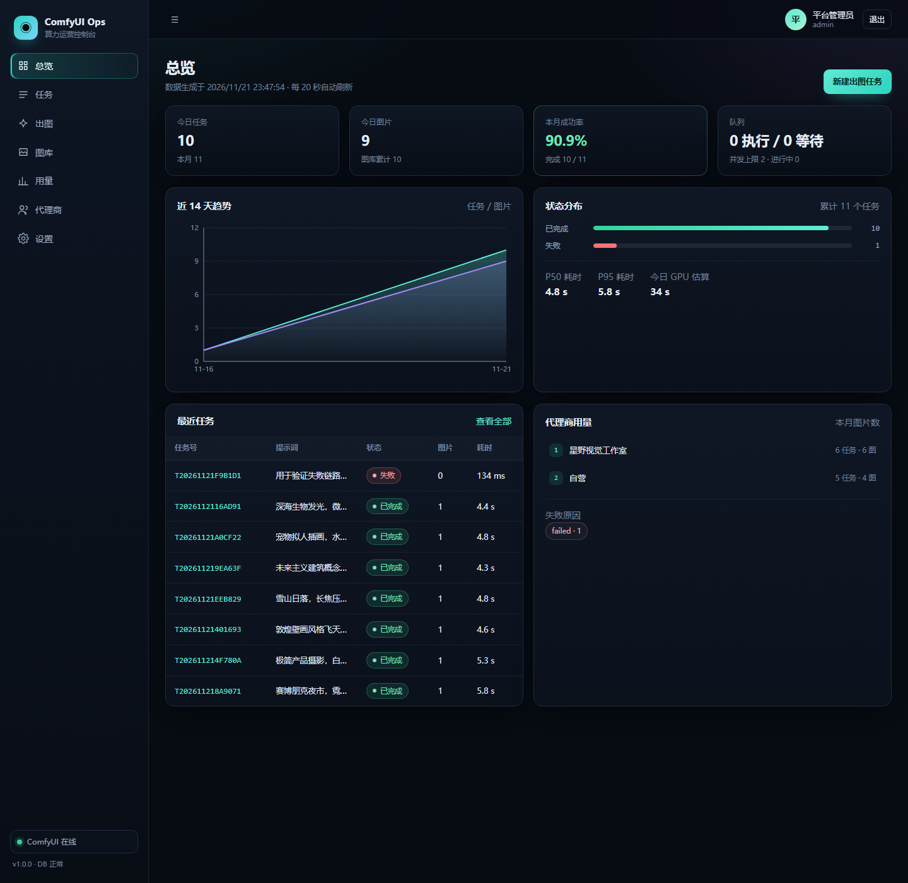
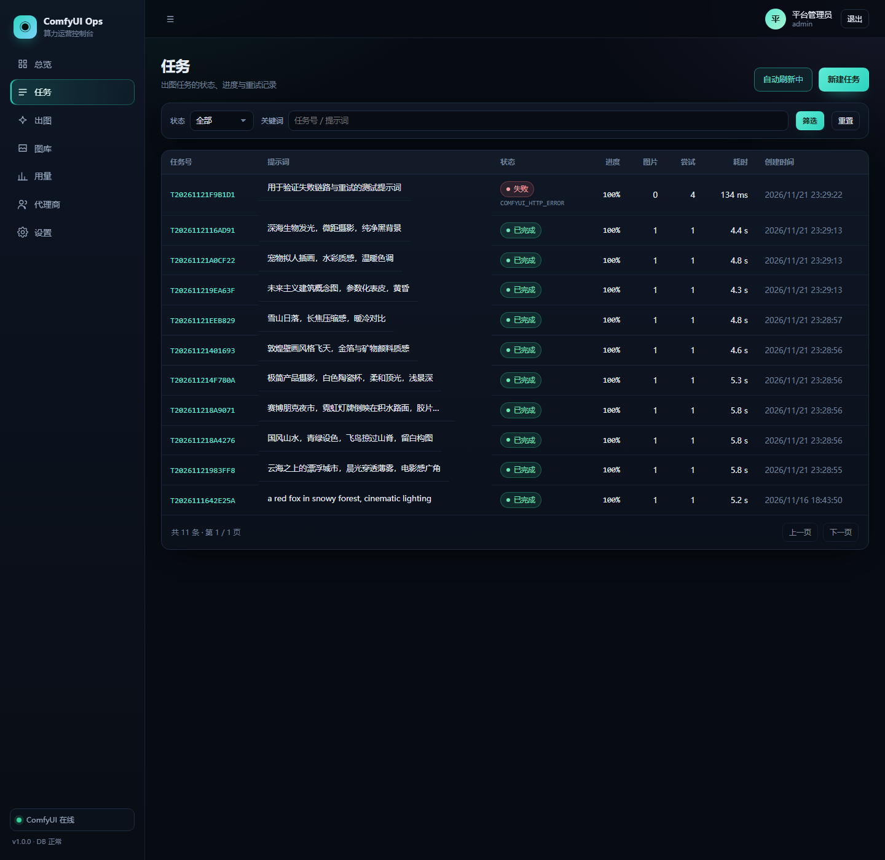
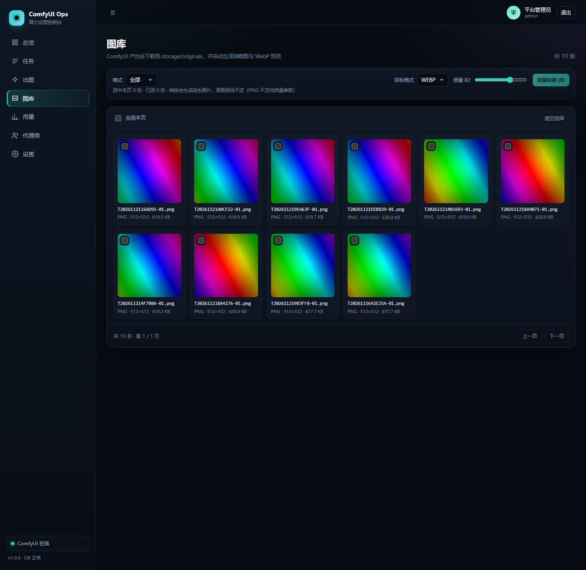
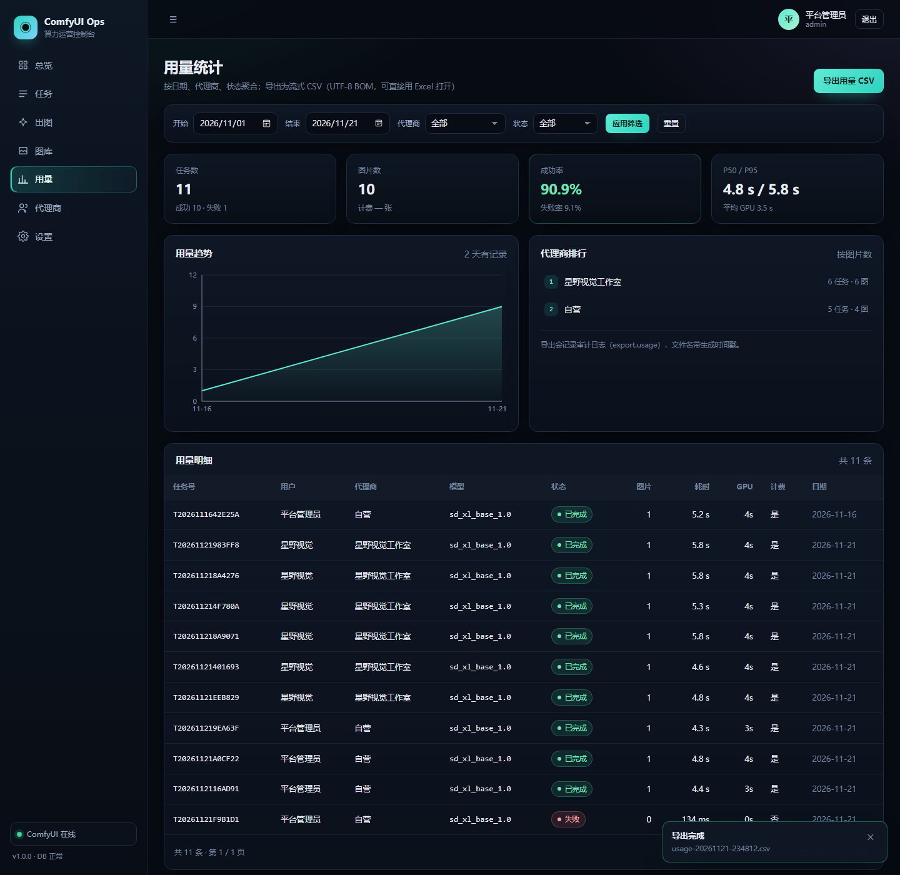
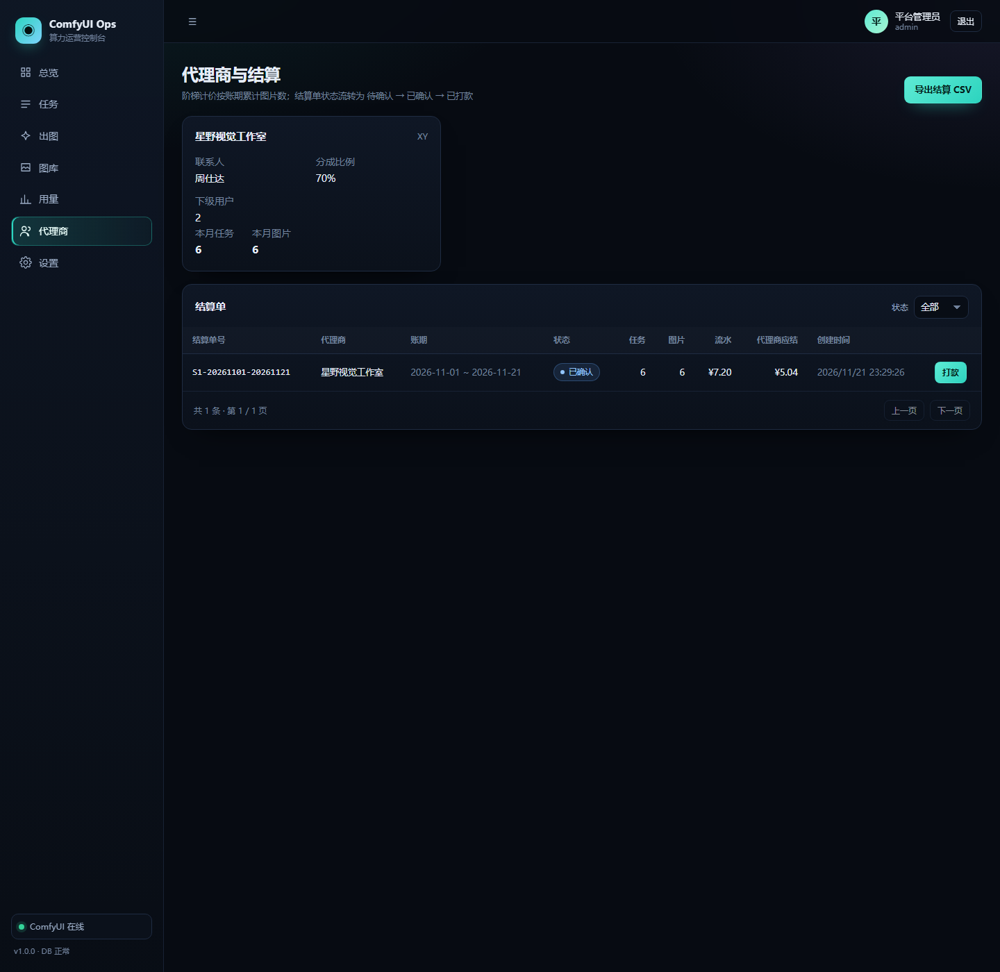
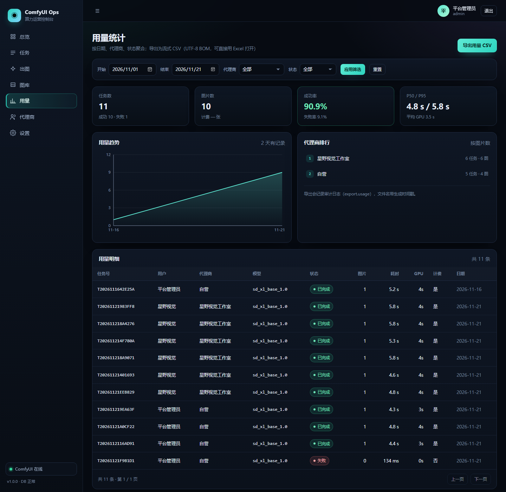
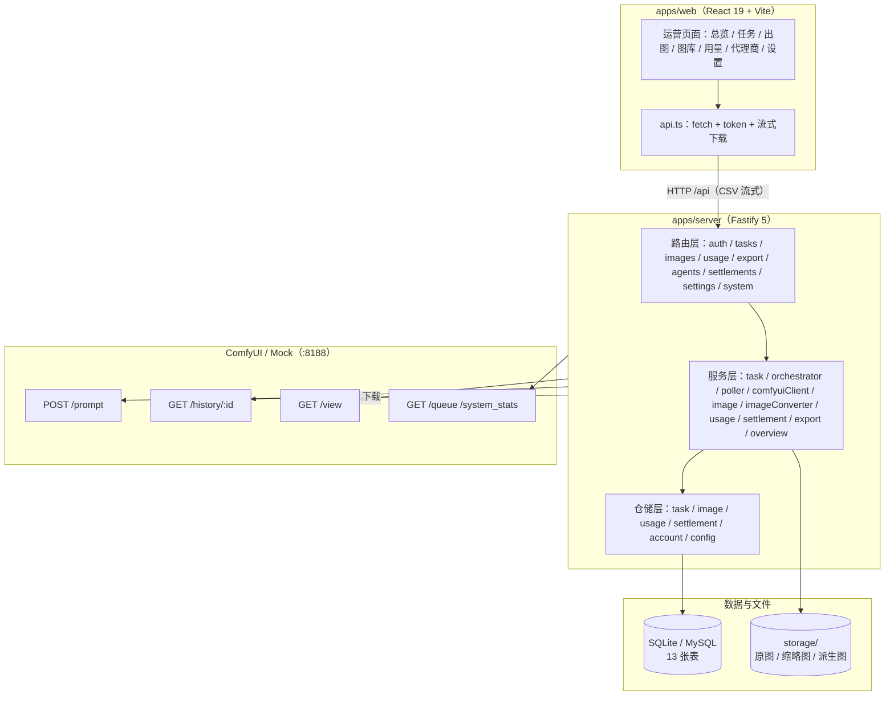
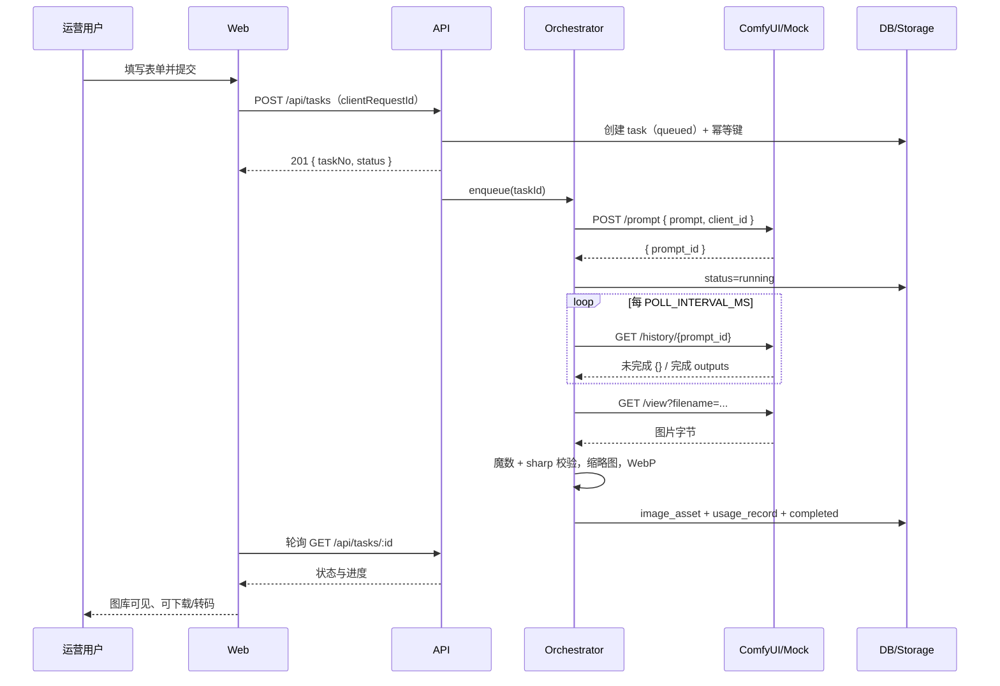

# ComfyUI Ops Console

**AI 出图运营管理控制台**：React 运营后台 + Fastify 编排服务 + ComfyUI 模拟服务。覆盖从「提交出图任务」到「图片产物管理」再到「用量统计 / 代理商结算 / CSV 导出」的完整运营闭环，可在无 GPU、无真实 ComfyUI 的环境下一键跑通。


> 作品集定位：对标「React 前端开发实习生（AI 出图运营平台）」岗位，重点展示 **前端页面交互 + 服务端接口 + CSV 导出 + ComfyUI 接入 + 测试与文档** 的交付完整度。

## 界面预览

以下截图均由 `scripts/capture-screenshots.mjs` 通过 Edge headless + CDP 对真实运行中的前端页面截取（1440×1400），数据来自内置 mock 真实出图链路，不是设计稿或占位图。

| 运营总览（用量/趋势/状态分布） | 任务列表（状态机/进度/失败重试） |
| --- | --- |
|  |  |

| 图库（真实 PNG 产物/转码） | 用量统计与 CSV 导出 |
| --- | --- |
|  |  |

| 代理商与结算（阶梯计价/状态流转） | 用量明细 |
| --- | --- |
|  |  |

## 为什么做这个项目

AI 出图团队的真实工作不是「点一下生成」：运营要盯任务成功率、排查超时与上游故障、按代理商核算成本、定期导出对账数据；研发要保证 ComfyUI 不稳定时任务不丢、不重复扣费，并让图片产物可追溯。这个项目把这些环节做成一个可运行的控制台：

- **有真实链路**：提交节点图 → 轮询 `/history` → 下载 `/view` → 魔数校验 → 缩略图/WebP → 落库计费，全部真实执行。
- **有运营视角**：任务状态、进度、失败原因、P50/P95、代理商用量、阶梯结算，都能在界面上看到。
- **有工程约束**：mock 可注入失败/超时/服务未启动；服务端 46 个单测；前端产物无头检查；E2E 冒烟脚本。
- **有交付意识**：运行手册、接入说明、兼容性评估、API 文档、部署文档全部随仓库提供。

## 功能清单

### 运营后台（React 19 + Vite）

- [x] 登录 / 登出，token 持久化，未登录路由守卫
- [x] 运营总览：今日/本月任务与图片量、成功率、状态分布、P50/P95、14 天趋势、最近任务、代理商排行、失败原因
- [x] 任务列表：状态/关键词/日期筛选、分页、进度、尝试次数、错误码
- [x] 任务详情：完整参数、提示词、错误详情、尝试轨迹、图片产物、失败重试
- [x] 出图表单：模板、提示词/负向提示词、seed/steps/cfg/尺寸/批量
- [x] 图库：缩略图网格、格式筛选、原图预览、下载、单图转码、批量转码、批量下载
- [x] 用量统计：筛选、成功率/失败率、P50/P95、趋势、按代理商/用户聚合、明细
- [x] CSV 导出：用量 CSV、结算 CSV（页面按钮 + 下载进度 + 完成提示）
- [x] 代理商与结算：代理商卡片、结算预览、结算单创建/确认/打款、状态筛选
- [x] 设置：ComfyUI 地址、超时、轮询、并发、缩略图尺寸、连接测试
- [x] 系统状态、审计日志（接口）
- [x] 响应式深色 UI、Toast、空态、加载态、错误态

### 服务端（Fastify + Knex + SQLite/MySQL）

- [x] 统一响应 `{ success, data }` / 统一错误码；zod 参数校验
- [x] HMAC-SHA256 token、scrypt 密码哈希、角色鉴权（admin/operator/agent/user）
- [x] 任务状态机：`queued → submitted → running → polling → downloading → completed / failed / timeout / unreachable`
- [x] 编排器：并发控制、指数退避重试、任务总超时、服务重启自愈
- [x] 幂等提交：`unique(user_id, client_request_id)`
- [x] ComfyUI 客户端：错误分类（timeout / unreachable / http / invalid_response）
- [x] 轮询器：固定间隔 + 总超时 + 可重试错误重试
- [x] 图片：PNG/JPEG/WebP 魔数校验、sharp 解码、256px 缩略图、WebP 派生图、sha256
- [x] 格式转换：PNG ⇄ JPEG ⇄ WebP，可指定质量
- [x] 用量聚合：成功率/失败率、P50/P95/平均耗时、按日/代理商/用户
- [x] 代理商结算：阶梯计价 + 分成，整数分金额，跨档拆分明细
- [x] CSV 导出：UTF-8 BOM、中文表头、转义、分页拉取、流式响应、时间戳文件名、审计
- [x] 审计日志：登录、任务、导出、结算、设置变更
- [x] 存储抽象：本地磁盘（可按接口替换对象存储）

### ComfyUI Mock 与工程化

- [x] Mock 原生接口：`/prompt`、`/history/{id}`、`/view`、`/queue`、`/system_stats`、`/object_info`
- [x] 节点图校验：必填输入、连线节点存在性、输出节点检查，400 返回 `node_errors`
- [x] 真实 PNG 生成（非占位图）、0→100% 进度
- [x] 故障注入：`ok / slow / fail / partial / dead`
- [x] 服务端 vitest 46 用例、E2E 冒烟脚本、前端产物检查脚本
- [x] Dockerfile、docker-compose、Nginx 配置
- [x] README + 6 份标准文档 + 3 份专项文档 + 真实截图

## 技术栈

| 层 | 技术 | 说明 |
| --- | --- | --- |
| 前端框架 | React 19.3 + TypeScript 5.9 | 函数组件 + Hooks |
| 路由 | react-router-dom 7（HashRouter） | 兼容静态托管与 Electron `file://` |
| 数据请求 | @tanstack/react-query 5 | 缓存、重试、失效 |
| 状态 | zustand 5（persist） | 登录态与 token |
| 图表 | recharts 3 | 趋势与分布 |
| 构建 | Vite 8（Rolldown） | 代码分割、产物检查 |
| 服务端 | Fastify 5 + TypeScript | 路由、鉴权钩子、流式响应 |
| 数据访问 | Knex 3 + better-sqlite3 13 / mysql2 / pg | 默认 SQLite，可切 MySQL/PG |
| 校验 | zod 4 | 请求参数与查询 |
| 图片 | sharp 0.35 | 解码、缩略图、格式转换 |
| 测试 | vitest 5 + supertest 7 | 46 个用例，不依赖外部服务 |
| Mock | Fastify 5 + 自研 PNG 编码 | 无第三方图像依赖 |
| 工程 | npm workspaces + concurrently | 多包脚本 |

## 系统架构



**出图时序**：



## 目录结构

```text
comfyui-ops-console/
├── apps/
│   ├── server/                 # Fastify API + 编排 + 数据库
│   │   ├── src/
│   │   │   ├── app.ts          # 应用装配、鉴权、错误处理
│   │   │   ├── config.ts       # 环境变量
│   │   │   ├── db/             # schema / seed / setup / knex
│   │   │   ├── http/           # dto / respond / auth
│   │   │   ├── lib/            # csv / image / password / token / errors / utils
│   │   │   ├── repositories/   # 数据访问
│   │   │   ├── routes/         # 36 个接口（含 /health）
│   │   │   └── services/       # 编排、轮询、客户端、转换、结算、导出
│   │   ├── test/               # vitest 46 用例
│   │   ├── data/               # SQLite 文件（运行时生成）
│   │   └── storage/            # 图片产物（运行时生成）
│   └── web/                    # React 运营后台
│       └── src/
│           ├── components/     # 布局、通用 UI
│           ├── pages/          # 10 个页面
│           ├── lib/            # api / format / status
│           └── store/          # auth / toast
├── services/comfyui-mock/      # ComfyUI 模拟服务
│   └── src/                    # server / graph / png / store / config
├── scripts/
│   ├── check-web.mjs           # 前端产物无头检查（26 项）
│   ├── e2e-smoke.mjs           # 真实链路冒烟
│   ├── demo-data.mjs           # 演示数据（任务/图片/结算）
│   └── capture-screenshots.mjs # Edge headless 截图
├── db/schema.mysql.sql         # MySQL 8 DDL（13 张表）
├── docker/nginx.conf           # 生产静态托管 + /api 反代
├── docs/                       # 6 份标准文档 + 3 份专项 + 截图
├── Dockerfile                  # 多阶段：deps/build/server/mock/web
├── docker-compose.yml          # mock + server + web（可选 mysql）
├── .env.example                # 全部环境变量
└── package.json                # workspaces 脚本
```

## 快速开始

### 环境要求

- Node.js ≥ 22（实测 v24.20.0）
- npm 11（或 pnpm 10+）
- 无需 Docker、MySQL、GPU

### 安装与启动

```bash
# 1) 安装依赖
npm install

# 2) 初始化数据库与种子数据（幂等）
npm run db:setup
npm run db:seed

# 3) 同时启动 mock(8188) + API(3000) + Web(5173)
npm run dev
```

打开 <http://127.0.0.1:5173>，登录后进入「出图」提交任务。

> Windows PowerShell 中请使用 `npm.cmd`，并确保 Node 已加入 PATH；若 Vite 仅监听 IPv6，使用 `npm run dev:web -- --host 127.0.0.1` 或访问 `http://localhost:5173`。

### 分步启动

```bash
npm run dev:mock     # ComfyUI mock  http://127.0.0.1:8188
npm run dev:server   # Fastify API   http://127.0.0.1:3000
npm run dev:web      # Vite dev      http://127.0.0.1:5173
```

### 构建与验收

```bash
npm run build        # mock + server + web 全量构建
npm test             # 服务端 vitest（46 用例）
npm run check:web    # 前端产物检查（26 项，退出码 0）
npm run smoke        # E2E 冒烟（需 server + mock 已启动）
npm run verify       # build + test + check:web
```

### 演示数据与截图

```bash
node scripts/demo-data.mjs          # 9 个成功任务 + 1 个失败任务 + 结算单
node scripts/capture-screenshots.mjs # 重新生成 docs/screenshots/
```

## 默认账号

| 角色 | 邮箱 | 密码 | 说明 |
| --- | --- | --- | --- |
| 平台管理员 | `admin@ops.local` | `Admin@123456` | 全部权限：结算、设置、导出 |
| 运营 | `operator@ops.local` | `Ops@123456` | 运营看板与任务 |
| 代理商 | `studio@ops.local` | `Studio@123456` | 星野视觉工作室（agent_id=1） |
| 创作者 | `creator@ops.local` | `Creator@123456` | 普通用户，提交出图 |

> 以上仅用于本地演示；上线前必须修改或禁用。

## 主要接口

完整说明见 [docs/api.md](docs/api.md)（含请求/响应示例、CSV 格式、错误码）。

| 分组 | 接口 |
| --- | --- |
| 认证 | `POST /api/auth/login`、`GET /api/auth/me`、`POST /api/auth/logout` |
| 总览 | `GET /api/overview` |
| 任务 | `POST /api/tasks`、`GET /api/tasks`、`GET /api/tasks/:id`、`POST /api/tasks/:id/retry` |
| 图片 | `GET /api/images`、`/images/:id/file`、`/thumbnail`、`/download`、`POST /images/:id/convert`、`POST /images/batch-convert`、`POST /images/bundle` |
| 用量 | `GET /api/usage/stats`、`GET /api/usage/records` |
| 导出 | `GET /api/export/usage.csv`、`GET /api/export/settlements.csv` |
| 代理商 | `GET /api/agents`、`GET /api/agents/:id`、`GET /api/agents/:id/settlement-preview` |
| 结算 | `GET/POST /api/settlements`、`GET /api/settlements/:id`、`POST /:id/confirm`、`POST /:id/pay` |
| 设置 | `GET/PUT /api/settings`、`POST /api/settings/test` |
| 系统 | `GET /api/system/status`、`GET /api/system/audit-logs`、`GET /api/system/summary`、`GET /api/health` |

## 测试

全部测试不依赖外部服务：ComfyUI client 用进程内 HTTP 假服务，API 测试用 supertest + 临时 SQLite。

| 测试文件 | 用例数 | 覆盖 |
| --- | --- | --- |
| `test/comfyuiClient.test.ts` | 7 | 提交、节点错误、超时、连接拒绝、下载、历史、系统状态 |
| `test/poller.test.ts` | 6 | 退避计算、可重试/不可重试、轮询完成、总超时 |
| `test/image.test.ts` | 7 | 魔数识别、PNG/JPEG/WebP、缩略图、格式转换、非法字节 |
| `test/csv.test.ts` | 7 | BOM、转义、中文表头、金额格式化、文件名、分页流 |
| `test/settlement.test.ts` | 9 | 阶梯计价、跨档拆分、分成、边界、状态流转 |
| `test/api.test.ts` | 10 | 登录/鉴权、任务提交与幂等、端到端出图、连接拒绝 |
| **合计** | **46** | **6 个文件全部通过** |

本次实测结果（2026-11-22）：

```text
Test Files  6 passed (6)
     Tests  46 passed (46)
  Duration  61.36s
```

`pnpm -r build` 与 `pnpm -r test` 也已跑通（构建 EXIT=0、46 用例全绿，测试耗时 42.48s）。pnpm 安装阶段会提示 `Ignored build scripts: esbuild`，这是 pnpm 默认的安全策略，不影响已安装的预编译产物与构建结果。

其他验收数据：

| 项 | 命令 | 结果 |
| --- | --- | --- |
| 构建 | `npm run build` | 成功，487 modules，3.03s |
| 前端产物 | `npm run check:web` | 26/26 通过，退出码 0；JS 768.0 KB（gzip 221.8 KB），CSS 22.5 KB |
| E2E 冒烟 | `node scripts/e2e-smoke.mjs` | 通过；任务 `T2026112270877C` 完成，耗时 8276ms，PNG 632,540 字节 |
| 演示数据 | `node scripts/demo-data.mjs` | 9 个 completed、10 张 PNG、1 个 failed（attempts=4） |
| 截图 | `node scripts/capture-screenshots.mjs` | 6 张 1440×1400 真实界面截图 |

### 故障场景验证

| 场景 | 操作 | 预期 |
| --- | --- | --- |
| 服务未启动 | mock 切 `dead` 后提交 | 任务 `unreachable` / `COMFYUI_UNREACHABLE` |
| 请求超时 | mock 切 `slow`，并把 `MOCK_SLOW_MS` 调到大于 `COMFYUI_REQUEST_TIMEOUT_MS`（如 15000 vs 10000） | 任务 `timeout` / `COMFYUI_TIMEOUT` |
| 上游 500 | mock 切 `fail` | 重试 3 次后 `failed` / `COMFYUI_HTTP_ERROR`（attempts=4） |
| 图片损坏 | mock 切 `partial` | `failed`，图片校验拦截 |

## 与岗位要求对应

JD 六条逐条落地位置：

| # | 岗位要求 | 实现 | 关键文件 | 验证 |
| --- | --- | --- | --- | --- |
| ① | 运营后台用量与代理商结算数据 CSV 导出（服务端接口 + 页面交互 + 单测） | 两个流式 CSV 接口、中文表头/BOM/转义/时间戳文件名/审计；用量页与代理商页导出按钮、下载进度、toast | `apps/server/src/services/exportService.ts`、`apps/server/src/lib/csv.ts`、`apps/server/src/routes/usage.ts`、`apps/web/src/pages/Usage.tsx`、`apps/web/src/pages/Agents.tsx`、`apps/server/test/csv.test.ts` | `csv.test.ts` 7 用例；截图 `04-usage-csv-export.png`；真实下载 `usage-20261121-234812.csv` |
| ② | ComfyUI 模拟服务 mock | 原生 6 个接口、节点图校验、真实 PNG、0→100% 进度、5 种故障模式、管理接口 | `services/comfyui-mock/src/server.ts`、`graph.ts`、`png.ts`、`store.ts` | `system_stats` 返回 `0.3.68-mock`；`dead/slow/fail/partial` 均驱动出预期状态 |
| ③ | ComfyUI 接入（任务提交/结果轮询/图片回传/格式转换，覆盖失败/超时/服务未启动） | HTTP 客户端错误分类、轮询与退避、任务状态机、图片下载+魔数校验+缩略图+WebP、PNG⇄JPEG⇄WebP 转码 | `apps/server/src/services/comfyuiClient.ts`、`poller.ts`、`orchestrator.ts`、`imageConverter.ts`、`lib/image.ts` | 46 用例中 20+ 覆盖链路；E2E 实跑完成；三类异常均有状态码断言 |
| ④ | 服务端 vitest 用例 + 客户端无头检查脚本 | 6 个测试文件 46 用例；`check-web.mjs` 检查 dist 26 项并以退出码表达结果 | `apps/server/test/*.test.ts`、`scripts/check-web.mjs`、`scripts/e2e-smoke.mjs` | `npm test` 46 passed；`check:web` 26/26、EXIT=0 |
| ⑤ | 本地运行手册 + ComfyUI 接入说明 + 兼容性评估报告 | 三份专项文档，含启动、故障注入、对接真实 ComfyUI、兼容矩阵与风险 | `docs/runbook-local.md`、`docs/comfyui-integration.md`、`docs/compatibility-assessment.md` | 文档均引用真实命令与实测结果 |
| ⑥ | 接口联调与上线验证 | 36 个接口、统一响应/错误码、审计、系统状态；部署文档 + Docker/Nginx + 上线检查清单 | `docs/api.md`、`docs/deployment.md`、`Dockerfile`、`docker-compose.yml`、`docker/nginx.conf`、`scripts/e2e-smoke.mjs` | E2E 冒烟通过；接口联调覆盖登录→任务→图片→总览 |

### 文档索引

| 文档 | 内容 |
| --- | --- |
| [docs/requirements.md](docs/requirements.md) | 需求、角色、用户故事、验收标准 |
| [docs/architecture.md](docs/architecture.md) | 架构、时序、状态机、模块职责 |
| [docs/database.md](docs/database.md) | 13 张表、ER 图、字段、索引、结算公式 |
| [docs/api.md](docs/api.md) | 36 个接口、示例、CSV、错误码 |
| [docs/deployment.md](docs/deployment.md) | 本地/生产部署、Nginx、Docker、环境变量、上线清单 |
| [docs/roadmap.md](docs/roadmap.md) | 已完成、后续计划、风险 |
| [docs/runbook-local.md](docs/runbook-local.md) | 本地运行与排障手册 |
| [docs/comfyui-integration.md](docs/comfyui-integration.md) | ComfyUI 接口契约、状态机、异常、mock |
| [docs/compatibility-assessment.md](docs/compatibility-assessment.md) | 兼容性矩阵、差异、风险与验证证据 |
| [docs/CONTRIBUTING.md](docs/CONTRIBUTING.md) | 贡献指南与提交前检查 |

## 后续规划

- **接入真实 ComfyUI**：WebSocket 实时进度、多实例/多 GPU 调度、`object_info` 动态表单、任务取消。
- **运营能力**：任务批量操作、告警通知、定价规则管理界面、结算对账/发票、RBAC、对象存储/CDN。
- **稳定性**：外部队列（Redis/BullMQ）支持多实例、数据库迁移与索引优化、限流熔断、Prometheus 指标、10 万行导出压测。
- **客户端**：Electron 桌面打包（`base: './'` 与 HashRouter 已预留）、前端单测与 Playwright E2E、可访问性优化。

## 已知限制

- 编排队列与并发控制在进程内，多实例部署需外部队列。
- 图片默认存本地磁盘，多副本需对象存储。
- Docker 编排文件未在本机实际运行（交付环境无 Docker），仅按标准编写。
- 真实 ComfyUI 联调需按实际工作流调整模板 `graph_json` 与模型名；未接 WebSocket，进度为轮询 + 估算。
- 演示账号与默认 `JWT_SECRET` 仅用于本地，上线前必须更换。

## 许可证

[MIT](LICENSE) © 2026 zhoushiba
