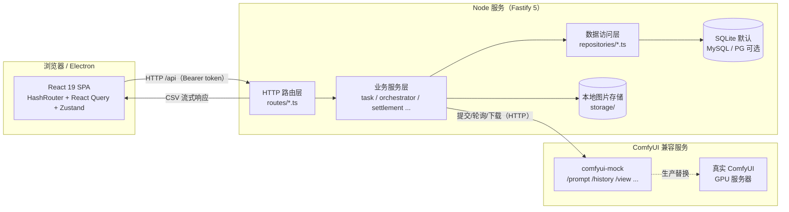
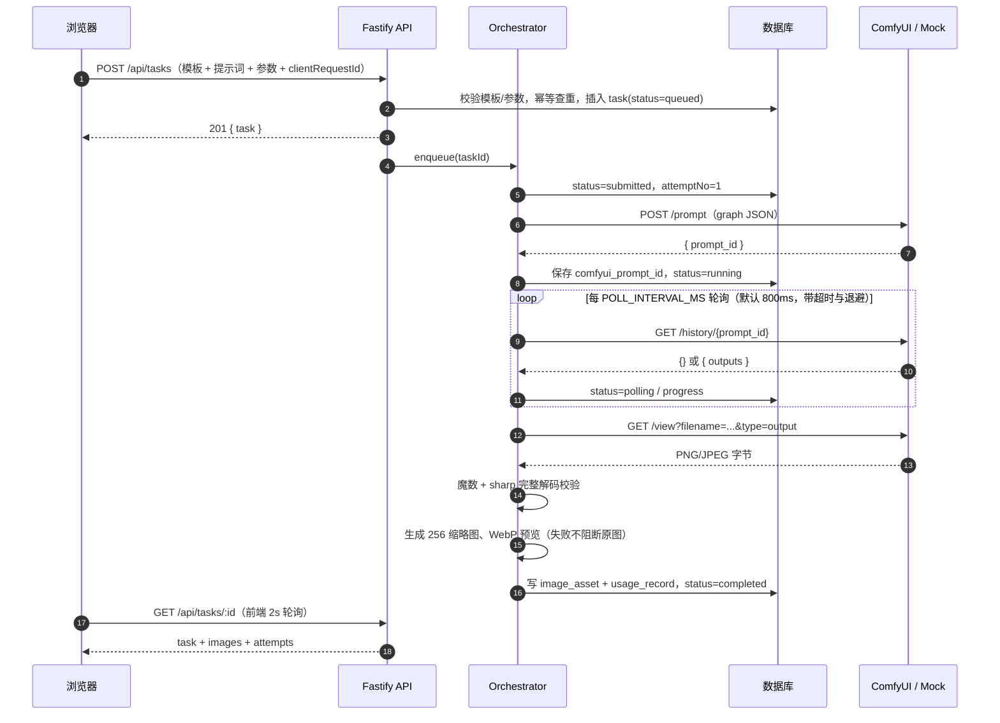
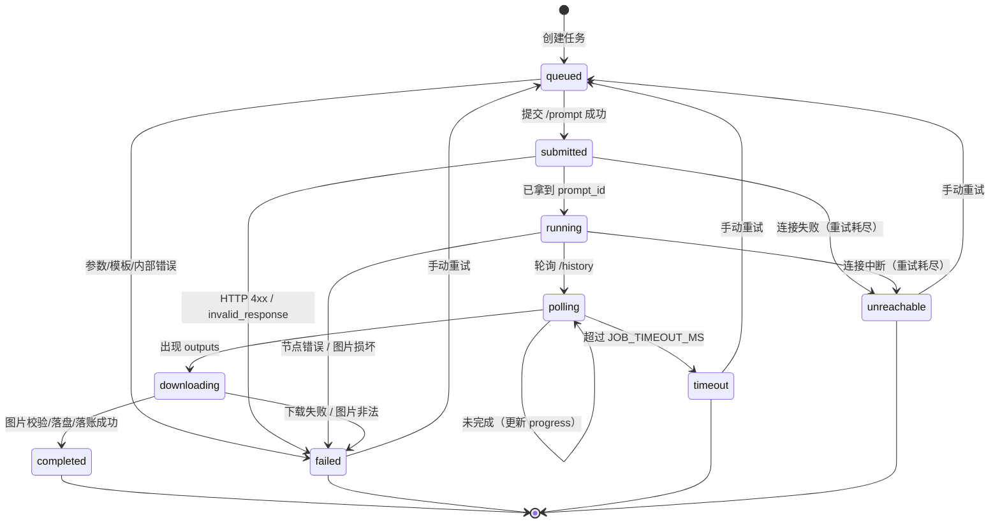

# 系统架构（Architecture）

## 1. 总体架构

系统由三个可独立启动的进程组成，本地用 `concurrently` 一键拉起，生产可容器化拆分部署。



设计要点：

- **前后端分离**：前端只依赖 `/api` 契约，开发期由 Vite 代理到 `http://127.0.0.1:3000`，生产由 Nginx 反代。
- **服务端分层**：`routes` 只做参数校验与响应封装，`services` 承载业务，`repositories` 封装 SQL，便于单测替身。
- **ComfyUI 可替换**：`comfyuiClient` 只依赖 HTTP 契约，通过 `system_config` 的 `comfyui.baseUrl` 热切换 mock 与真实服务。
- **单实例内存队列**：编排器进程内并发控制（默认 2），任务状态持久化在 DB，重启可恢复。

## 2. 模块职责

| 模块 | 路径 | 职责 |
| --- | --- | --- |
| Web 应用 | `apps/web/src` | 路由、页面、React Query 数据获取、Zustand 登录态、图表 |
| API 服务 | `apps/server/src` | 认证、任务、图片、用量、结算、设置、系统接口 |
| 编排器 | `apps/server/src/services/orchestrator.ts` | 任务生命周期、重试、并发、恢复、用量落账 |
| 轮询器 | `apps/server/src/services/poller.ts` | history 轮询、总超时、指数退避 |
| ComfyUI 客户端 | `apps/server/src/services/comfyuiClient.ts` | 封装 ComfyUI HTTP API 与错误分类 |
| 图片处理 | `apps/server/src/services/image*.ts`、`lib/image.ts` | 魔数校验、sharp 解码、缩略图、格式转换 |
| CSV | `apps/server/src/lib/csv.ts`、`services/exportService.ts` | BOM、转义、分页拉取、流式写出、审计 |
| 结算 | `apps/server/src/services/settlement*.ts` | 阶梯计价、分成、账期、状态流转 |
| Mock 服务 | `services/comfyui-mock/src` | 真实接口形状、PNG 生成、故障注入 |

## 3. 出图任务链路



关键行为：

1. **幂等**：`generation_task` 上 `UNIQUE(user_id, client_request_id)`；重复提交返回已存在任务，不重复扣费。
2. **重试**：仅 `unreachable` / `timeout` / HTTP 5xx 可重试；`MAX_RETRIES=3` 时最多 4 次尝试，第 n 次退避 `min(500ms × 2^(n-1), 8000ms)`，每次尝试写入 `task_attempt`。
3. **超时**：单次 HTTP 请求 `COMFYUI_REQUEST_TIMEOUT_MS=10000`；整任务 `JOB_TIMEOUT_MS=60000`，超时后状态 `timeout`、错误码 `COMFYUI_TIMEOUT`。
4. **服务未启动**：连接被拒（`ECONNREFUSED` 等）归一为 `unreachable`，状态 `unreachable`、错误码 `COMFYUI_UNREACHABLE`。
5. **图片校验**：读取首字节判断 PNG/JPEG 魔数，再用 sharp 完整解码；截断或伪造图片直接判失败，避免脏图入库。
6. **格式转换**：原图保存后生成 256px 缩略图与 WebP 预览；转码接口支持 PNG ⇄ JPEG ⇄ WebP 与质量参数。

## 4. 任务状态机



- 终态：`completed / failed / timeout / unreachable`。
- 运行态：`queued / submitted / running / polling / downloading`。
- 服务重启时，`recover()` 把中断中的运行态任务置为 `failed`，把仍 `queued` 的任务重新入队，避免僵尸任务。
- 失败重试只允许从三个失败终态回到 `queued`，并清空错误信息、重新累计 `attempts`。

## 5. 错误分类

| ComfyUI 客户端错误 | 触发条件 | 任务状态 | 错误码 | 是否重试 |
| --- | --- | --- | --- | --- |
| `timeout` | 请求超时 / 整体轮询超时 | `timeout` | `COMFYUI_TIMEOUT` | 是 |
| `unreachable` | `ECONNREFUSED`、DNS、连接重置 | `unreachable` | `COMFYUI_UNREACHABLE` | 是 |
| `http` 5xx | 对端 500/502/503 | `failed` | `COMFYUI_HTTP_ERROR` | 是 |
| `http` 4xx | 参数/工作流被拒 | `failed` | `COMFYUI_HTTP_ERROR` | 否 |
| `invalid_response` | JSON 结构不符、图片损坏 | `failed` | `COMFYUI_INVALID_RESPONSE` / `IMAGE_INVALID` | 否 |

失败详情保留在 `generation_task.error_code / error_message / error_detail`，前端任务列表和详情均可见；每次尝试额外记入 `task_attempt`（含状态码、耗时、错误摘要）。

## 6. 前端结构

```text
apps/web/src
├─ main.tsx          # HashRouter + QueryClient（401 不重试，5xx 重试 2 次）
├─ App.tsx           # 路由表 + RequireAuth
├─ components/       # AppLayout / ui（卡片、按钮、徽章、Toast）
├─ lib/api.ts        # fetch 封装、401 跳登录、CSV/文件下载
├─ lib/format.ts     # 金额/耗时/日期格式化
├─ store/            # Zustand：auth（持久化 token）、toast
└─ pages/            # Login/Overview/Tasks/TaskDetail/Create/Gallery/Usage/Agents/AgentDetail/Settings
```

- `HashRouter`：兼容静态托管与 Electron `file://`，刷新不 404。
- `React Query`：列表缓存与轮询（任务详情 2s、总览 20s）；4xx 不重试，5xx 重试 2 次。
- `Zustand persist`：登录态持久化到 `localStorage`（`comfyui-ops.token` + `comfyui-ops.auth`），刷新免登录。
- 图表用 `recharts`，按路由懒加载，构建产物单独拆 chunk（charts ≈ 412 KB）。

## 7. 可观测性与安全

- 健康检查：`GET /api/health` 返回状态与运行时长；前端顶栏显示 ComfyUI 在线状态、DB 状态与版本。
- 审计日志：登录、CSV 导出、结算创建/确认/打款、设置修改等写 `audit_log`。
- 认证：登录签发 HMAC-SHA256 token（payload 含 `sub/email/role/agentId/exp`，默认 12 小时）；服务端 `preHandler` 校验 `Authorization: Bearer`。
- 密码：`scrypt` + 随机盐，格式 `scrypt$<salt>$<hash>`，不存明文。
- 文件：下载名净化，防止路径穿越；图片只接受 PNG/JPEG，经 sharp 解码后才落盘。
- 生产注意：必须替换 `JWT_SECRET`、修改种子密码、启用 HTTPS、限制 CORS/来源。
