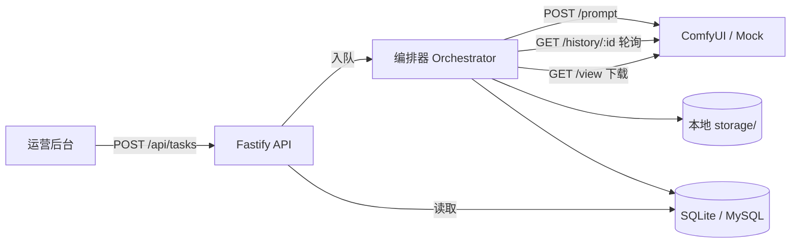
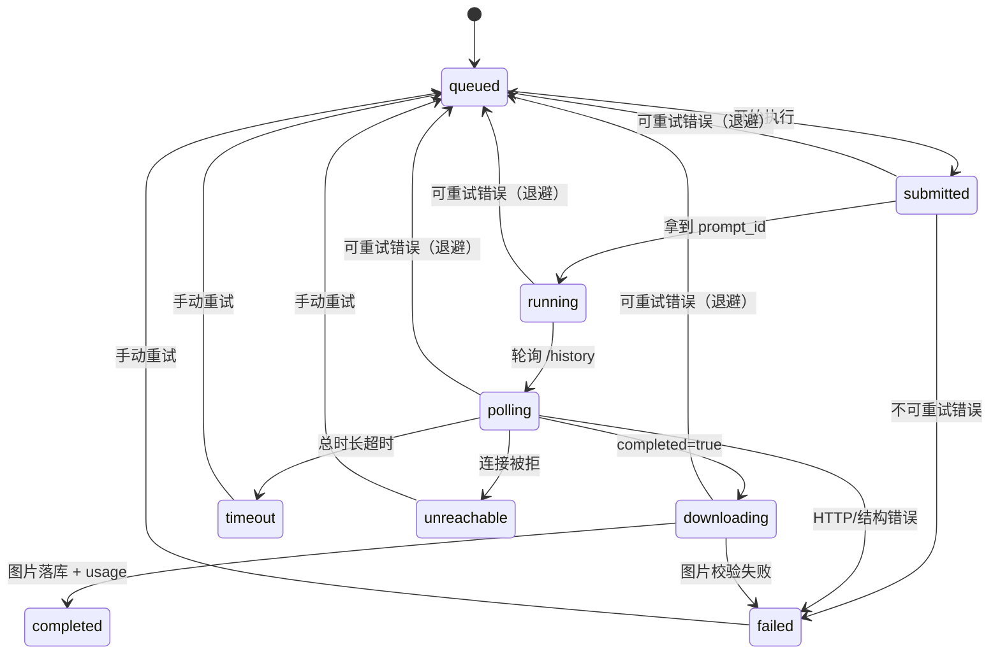

# ComfyUI 接入说明（Integration Guide）

本文说明本系统如何接入 ComfyUI：调用哪些接口、任务如何推进、异常如何分类、图片如何回传与转码，以及如何用内置 mock 做无 GPU 开发。

## 1. 接入架构



- 接入代码：`apps/server/src/services/comfyuiClient.ts`（HTTP 客户端）、`poller.ts`（轮询与重试）、`orchestrator.ts`（状态机）。
- Mock 实现：`services/comfyui-mock/src/server.ts`、`graph.ts`、`png.ts`、`store.ts`。
- 地址与超时可运行时修改：设置页 `PUT /api/settings`，无需重启。

## 2. ComfyUI HTTP 契约

服务端只依赖以下 6 个接口，均为 ComfyUI 原生 HTTP API。

### 2.1 `POST /prompt` 提交任务

请求：

```http
POST /prompt
Content-Type: application/json
```

```json
{
  "prompt": {
    "1": { "class_type": "CheckpointLoaderSimple", "inputs": { "ckpt_name": "sd_xl_base_1.0.safetensors" } },
    "2": { "class_type": "CLIPTextEncode", "inputs": { "text": "云海之上的漂浮城市", "clip": ["1", 1] } },
    "3": { "class_type": "CLIPTextEncode", "inputs": { "text": "低质量, 模糊", "clip": ["1", 1] } },
    "5": { "class_type": "EmptyLatentImage", "inputs": { "width": 512, "height": 512, "batch_size": 1 } },
    "4": {
      "class_type": "KSampler",
      "inputs": {
        "seed": 42, "steps": 24, "cfg": 7.5,
        "sampler_name": "euler", "scheduler": "normal", "denoise": 1,
        "model": ["1", 0], "positive": ["2", 0], "negative": ["3", 0], "latent_image": ["5", 0]
      }
    },
    "6": { "class_type": "VAEDecode", "inputs": { "samples": ["4", 0], "vae": ["1", 2] } },
    "9": { "class_type": "SaveImage", "inputs": { "images": ["6", 0], "filename_prefix": "ops" } }
  },
  "client_id": "ops-T2026112116AD91"
}
```

成功响应：

```json
{ "prompt_id": "b6f1c0d2-...", "number": 12, "node_errors": {} }
```

失败响应（HTTP 400）：

```json
{
  "error": {
    "type": "prompt_outputs_failed_validation",
    "message": "Prompt outputs failed validation",
    "details": "ckpt_name",
    "extra_info": {}
  },
  "node_errors": {
    "1": {
      "errors": [
        { "type": "required_input_missing", "message": "Required input is missing", "details": "ckpt_name", "extra_info": {} }
      ],
      "dependent_outputs": [],
      "class_type": "CheckpointLoaderSimple"
    }
  }
}
```

客户端处理：`prompt_id` 缺失或非字符串 → `invalid_response`；HTTP 非 2xx → `http` 错误并保留 `node_errors` 原文；`client_id` 用 `ops-<taskNo>`，便于在 ComfyUI 侧排查。

节点图来源：`prompt_template.graph_json` 存基准工作流，`templateService.render()` 按 `mapping`（promptNode / negativeNode / samplerNode / latentNode）写入提示词、seed、steps、cfg、宽高与批量，渲染结果再持久化到 `generation_task.graph_json`。

### 2.2 `GET /history/{prompt_id}` 查询结果

未完成时 ComfyUI 返回 `{}`；完成时返回：

```json
{
  "<prompt_id>": {
    "prompt": [ 12, "<prompt_id>", { }, { }, [ ] ],
    "outputs": {
      "9": {
        "images": [
          { "filename": "ops_00012_.png", "subfolder": "", "type": "output" }
        ]
      }
    },
    "status": { "status_str": "success", "completed": true, "messages": [ ] }
  }
}
```

客户端处理：
- 无 `[prompt_id]` 条目 → 返回 `null`，轮询继续。
- 有 `status` 且 `completed=true` → 完成；`status_str` 非 success 时交由编排层按失败处理。
- 结构缺 `status` → `invalid_response`。

注意：真实 ComfyUI 的 `outputs` 可能分散在多个输出节点，编排器会按节点顺序摊平所有 `images`。

### 2.3 `GET /view` 下载图片

```http
GET /view?filename=ops_00012_.png&subfolder=&type=output
```

返回原始图片字节。客户端不信任 `Content-Type`，下载后执行：

1. 魔数校验：PNG `89 50 4E 47`、JPEG `FF D8 FF`、WebP `RIFF....WEBP`。
2. `sharp` 完整解码（`metadata()`），确认宽高 > 0、非截断。
3. 计算 `sha256`、记录 `byte_size/width/height`。
4. 写入 `apps/server/storage/<taskNo>/`，生成 256px 缩略图与 WebP 派生图。

任一步失败 → `IMAGE_INVALID`，任务置 `failed`（不重试，避免重复计费）。

### 2.4 其他接口

| 接口 | 用途 | 失败影响 |
| --- | --- | --- |
| `GET /queue` | 查看队列长度 | 仅状态展示，可降级 |
| `GET /system_stats` | 版本与 GPU 设备 | 设置页连接测试、系统状态 |
| `GET /object_info` | 节点定义（mock 提供 5 个节点） | 后续动态表单预留，当前不阻塞出图 |

## 3. 任务状态机



- 进度：提交 5% → 运行 10% → 轮询 15%，轮询期间每 250ms 递增（上限 90%）→ 下载 95% → 完成 100%。
- 每次尝试写 `task_attempt`（成功/重试/最终失败、阶段、HTTP 状态、退避毫秒）。
- 终态写 `usage_record`（仅 completed 计费；失败记录也写入，`billable=0`）。
- `duration_ms` 为本次尝试耗时；`attempts` 为累计尝试次数；`gpu_seconds = round(durationMs/1000*0.5 + imageCount*1.2)`。

## 4. 异常分类与处理

| 场景 | 触发 | 客户端错误类型 | 可重试 | 最终状态 | 错误码 |
| --- | --- | --- | --- | --- | --- |
| 请求超时 | AbortController 超时 | `timeout` | 是 | `timeout` | `COMFYUI_TIMEOUT` |
| 服务未启动 | `ECONNREFUSED / ENOTFOUND / ECONNRESET` 等 | `unreachable` | 是 | `unreachable` | `COMFYUI_UNREACHABLE` |
| 5xx | HTTP ≥ 500 | `http` | 是 | `failed` | `COMFYUI_HTTP_ERROR` |
| 4xx / 节点错误 | HTTP 400/404 等 | `http` | 否 | `failed` | `COMFYUI_HTTP_ERROR` |
| 非 JSON / 缺字段 | 响应结构异常 | `invalid_response` | 否 | `failed` | `COMFYUI_INVALID_RESPONSE` |
| 图片截断/伪造 | 魔数或解码失败 | `AppError` | 否 | `failed` | `IMAGE_INVALID` |
| 轮询总超时 | 超过 `JOB_TIMEOUT_MS` | `timeout` | 是 | `timeout` | `COMFYUI_TIMEOUT` |

### 4.1 重试策略

- 仅 `retriable=true` 且 `attempts <= MAX_RETRIES`（默认 3）时重试。
- 退避：`computeBackoff(attempt) = min(500 * 2^(attempt-1), 8000)` 毫秒。
- 重试前清理该任务已有图片记录，避免重复。
- 重试用尽后按错误类型落终态，前端可手动重试（仅 `failed/timeout/unreachable`）。
- 下载阶段对 `/view` 使用 `poller.withRetry` 单独重试，避免整任务重跑。

### 4.2 服务重启恢复

- 启动时 `orchestrator.recover()`：执行中断的任务标记 `failed`（避免重复计费），`queued` 任务重新入队。
- 数据库中已有 `comfyui_prompt_id` 的任务重试时复用，不重复提交。

## 5. 图片回传与格式转换

| 步骤 | 实现 | 说明 |
| --- | --- | --- |
| 下载 | `GET /view` | 保持原始字节 |
| 校验 | `lib/image.ts probeImage` | 魔数 + sharp 解码 + 尺寸 + sha256 |
| 原图 | `storage/<taskNo>/<taskNo>-01.png` | 目录按任务归档 |
| 缩略图 | 256px（可配置 64–512） | 失败不影响原图 |
| 派生图 | 自动转 WebP（质量 82） | 失败不影响原图 |
| 手动转码 | `POST /images/:id/convert` / `batch-convert` | PNG ⇄ JPEG ⇄ WebP，可设质量 |
| 下载 | `GET /images/:id/download` | `Content-Disposition`，文件名净化 |
| 批量清单 | `POST /images/bundle` | 最多 100 张，返回文件清单 |

所有格式转换由 `sharp` 完成，统一走 `imageConverter.ts`；转换结果作为新 `image_asset` 记录（`source_image_id` 指向原图）。

## 6. 内置 Mock 服务

Mock 位于 `services/comfyui-mock`，用于无 GPU、无真实 ComfyUI 的开发与验收。

启动：`npm run dev:mock`（默认 `http://127.0.0.1:8188`）。

### 6.1 模拟接口

| 接口 | 行为 |
| --- | --- |
| `POST /prompt` | 校验节点图必填输入/连线/输出节点；失败返回 400 + `node_errors`；成功返回 `prompt_id` |
| `GET /history/:id` | 未完成返回 `{}`；完成后返回标准结构，`outputs` 指向 `/view` |
| `GET /view` | 用内置 PNG 编码器生成 512px 真实 PNG（非占位符） |
| `GET /queue` | 返回 running/pending 数组 |
| `GET /system_stats` | `comfyui_version: 0.3.68-mock`，带虚拟 GPU 设备 |
| `GET /object_info` | 5 个节点：CheckpointLoaderSimple、CLIPTextEncode、KSampler、VAEDecode、SaveImage |
| `GET /mock/progress/:id` | 0→100 的生成进度 |
| `GET /__admin/state` | 当前模式、任务、进度 |
| `POST /__admin/mode` | 切换 `ok / slow / fail / partial / dead` |
| `POST /__admin/reset` | 清空 mock 内存任务 |

### 6.2 故障注入

```powershell
$body = '{"mode":"fail"}'
Invoke-RestMethod -Method Post http://127.0.0.1:8188/__admin/mode -ContentType "application/json" -Body $body
```

| 模式 | 效果 | 覆盖场景 |
| --- | --- | --- |
| `ok` | 正常生成 | 成功链路 |
| `slow` | 响应延迟 `MOCK_SLOW_MS`（默认 5s；需大于请求超时才触发 timeout，可设为 15000） | 慢响应 / 请求超时 |
| `fail` | `/prompt` 返回 500 | 失败 + 重试 |
| `partial` | `/view` 返回截断的 128 字节 | 图片校验失败 |
| `dead` | 关闭监听 | 服务未启动（连接被拒） |

切回 `ok` 后恢复正常。`dead` 模式会真的释放端口，因此服务器侧得到的是真实 `ECONNREFUSED`，而不是模拟错误。

### 6.3 Mock 与真实服务的差异

| 差异点 | Mock | 真实 ComfyUI |
| --- | --- | --- |
| 生图速度 | 默认 3s（`MOCK_JOB_DURATION_MS`） | 取决于模型与 GPU |
| 图片内容 | 程序生成的渐变 PNG | 真实模型输出 |
| 进度 | 线性 0→100 | 节点级进度，需 WebSocket |
| 节点校验 | 6 类节点、必填输入、连线存在性 | 完整 `object_info` 驱动 |
| 队列 | 内存 | 真实执行队列 |
| 认证 | 无 | 默认无（置于内网/网关后） |

## 7. 配置项

| 配置 | 环境变量 | 默认 | 说明 |
| --- | --- | --- | --- |
| 地址 | `COMFYUI_BASE_URL` | `http://127.0.0.1:8188` | 设置页可热改 |
| 请求超时 | `COMFYUI_REQUEST_TIMEOUT_MS` | 10000 | 单次 HTTP |
| 轮询间隔 | `POLL_INTERVAL_MS` | 800 | `/history` 间隔 |
| 任务超时 | `JOB_TIMEOUT_MS` | 60000 | 轮询总时长 |
| 最大重试 | `MAX_RETRIES` | 3 | 提交/轮询/下载 |
| 并发 | `ORCHESTRATOR_CONCURRENCY` | 2 | 同时执行任务数 |
| 存储目录 | `STORAGE_DIR` | `./storage` | 图片落盘 |
| 缩略图 | `THUMBNAIL_SIZE` | 256 | 64–512 |

设置页保存后立即对 `ComfyUiClient`、`Poller`、`Orchestrator` 生效。

## 8. 对接真实 ComfyUI 的步骤

1. 启动 ComfyUI（默认 `http://127.0.0.1:8188`），确认 `/system_stats` 可访问。
2. 将真实工作流导出为 API 格式（`Save (API Format)`），替换 `prompt_template.graph_json`，或在种子数据中改模板。
3. 在设置页把 `ComfyUI 地址` 改为真实地址，点击「测试连接」。
4. 提交一条任务，观察 `generation_task.status` 与 `task_attempt`。
5. 若真实工作流使用不同节点 id，更新模板 `mapping`（提示词/采样器/潜空间节点）。
6. 若使用自定义节点或不同模型，确认 `ckpt_name` 与实际模型文件名一致。

## 9. 联调验证清单

- [ ] `POST /prompt` 成功返回 `prompt_id`。
- [ ] `GET /history/{id}` 完成后 `outputs` 含 `images`。
- [ ] `GET /view` 返回可解码 PNG/JPEG/WebP。
- [ ] 任务状态完整经历 `queued → completed`，前端进度可见。
- [ ] 图片落盘、缩略图可访问、WebP 派生图生成。
- [ ] 停掉 ComfyUI 后提交，任务最终 `unreachable`。
- [ ] 慢响应下任务最终 `timeout`（或按重试策略耗尽）。
- [ ] 400 节点错误时任务 `failed` 且 `error_detail` 保留原始 `node_errors`。
- [ ] CSV 导出包含真实任务数据。
- [ ] `npm test` 与 `npm run check:web` 通过。
